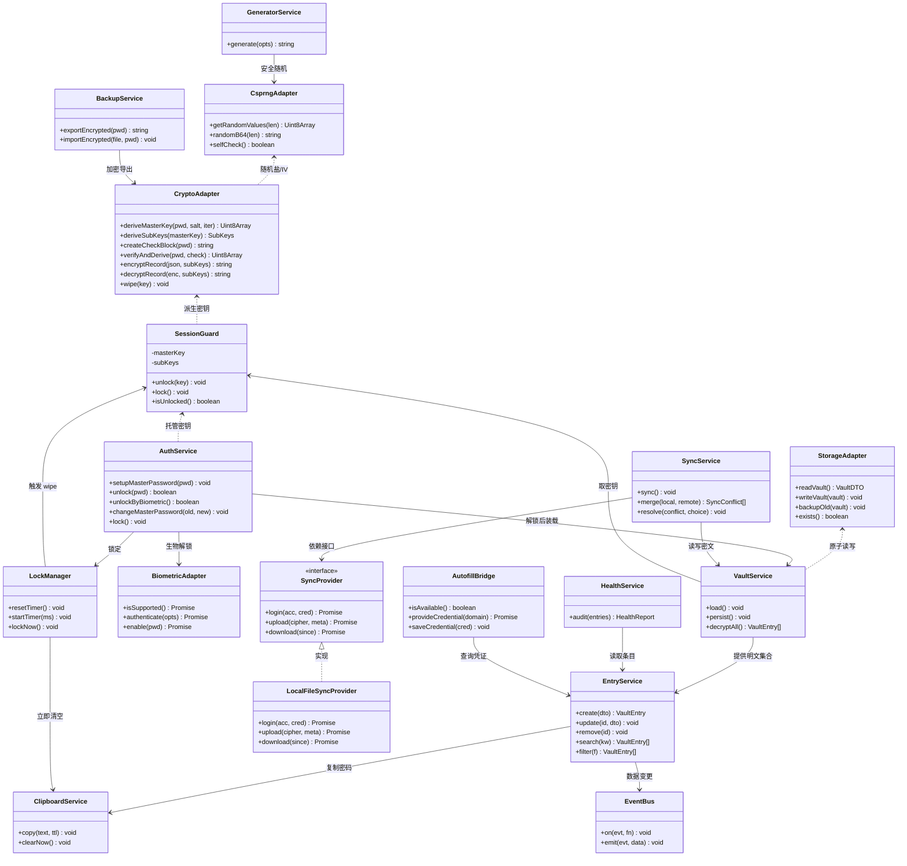
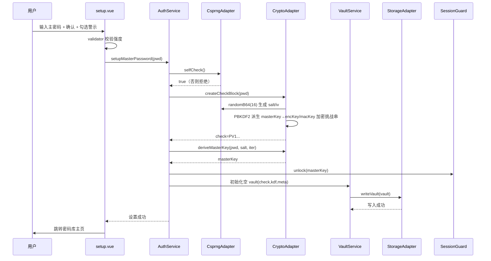
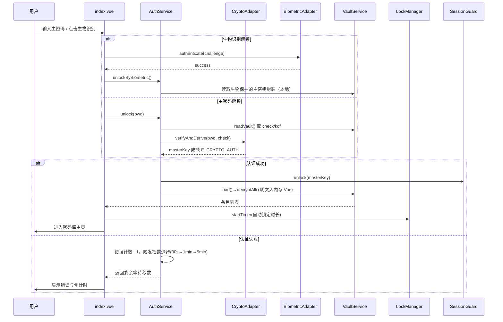
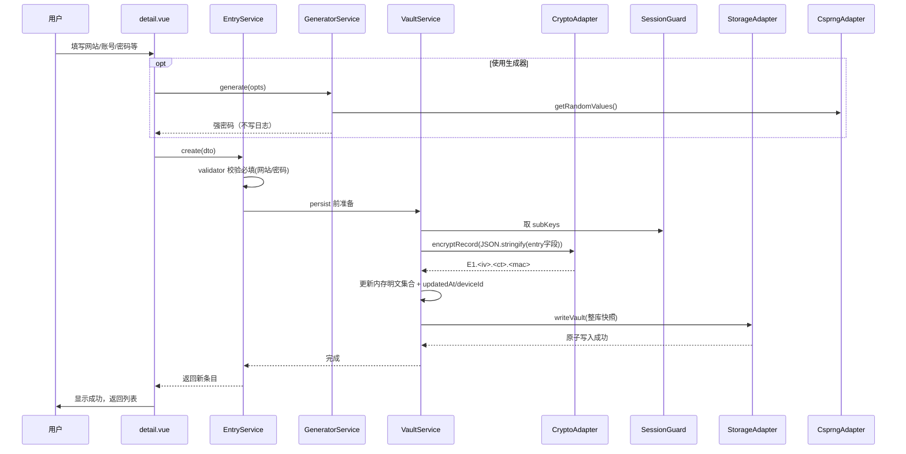
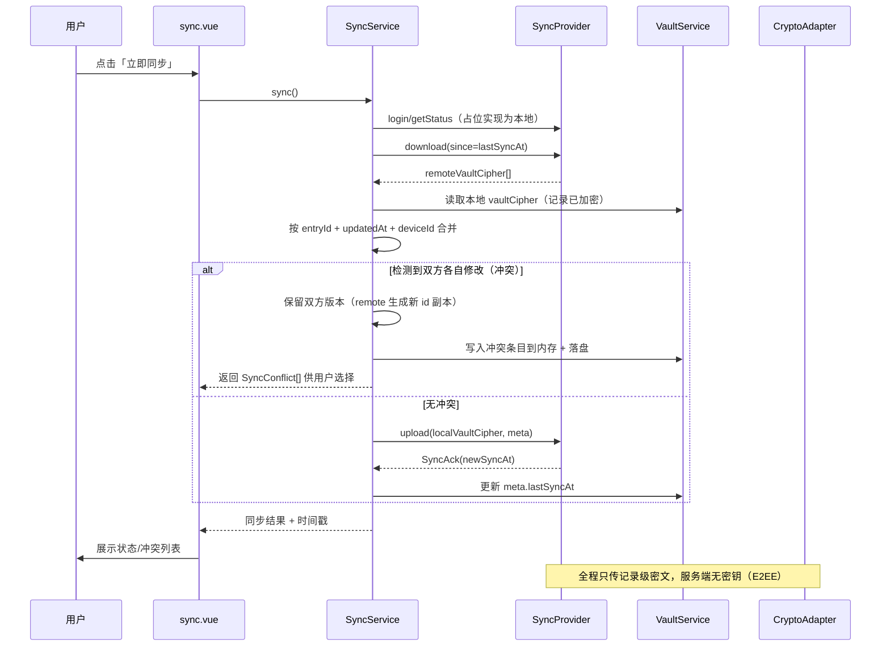
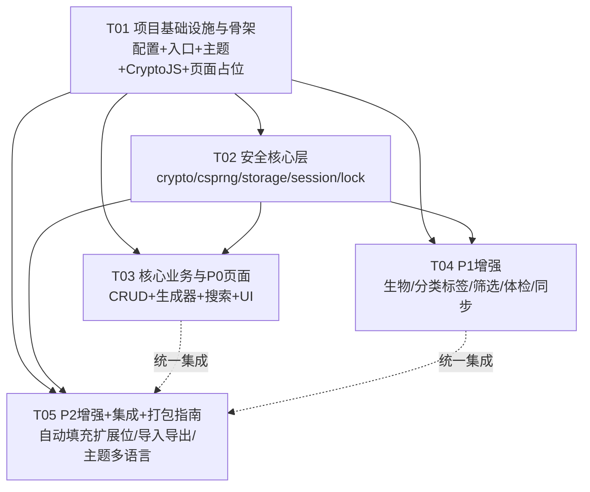

# 个人密码管理器 — 系统架构设计与任务分解

| 项目 | 内容 |
|---|---|
| 文档语言 | 简体中文 |
| 架构师 | 高见远（Gao） |
| 上游输入 | `docs/prd.md`（产品经理 PRD） |
| 项目名称 | `personal_password_vault` |
| 技术栈 | uni-app（Vue 3 选项式 API，HBuilderX / Vite 开发），打包 Android APK |
| 交付形式 | 完整源码 + HBuilderX 构建/打包指南 |
| 范围 | P0 + P1 + P2 全量（「功能最全版本」，不砍功能） |
| 设计原则 | 本地优先 · 纵深防御 · 开箱即用（零 npm install 重型依赖） · 分层解耦 · 扩展位预留 |

> 本文档分两部分：**Part A 系统设计**（实现方案、文件列表、数据结构与接口、调用流程、待明确事项）与 **Part B 任务分解**（依赖清单、任务列表、共享知识、依赖图）。
> 配套图文件：`docs/class-diagram.mermaid`、`docs/sequence-diagram.mermaid`。

---

# Part A — 系统设计

## 1. 实现方案与框架选型

### 1.1 核心技术难点

| # | 难点 | 说明 | 架构对策 |
|---|---|---|---|
| D1 | 主密码派生密钥且不落盘 | 需在不存原文/哈希可逆信息的前提下校验密码并加解密 | PBKDF2 派生密钥 + 校验块（用派生密钥解密固定挑战串），全链路只有密文落盘 |
| D2 | 无明文落盘 | 数据库/Storage 文件被拷贝也不能还原明文 | 记录级 AES-256-CBC + HMAC-SHA256（Encrypt-then-MAC），IV 每条独立随机 |
| D3 | 零重型依赖开箱即用 | HBuilderX 本地环境，追求导入即用 | CryptoJS 单文件本地化（`common/lib/crypto-js.min.js`），纯 JS、约 20KB、无 DOM 依赖；不引入 npm 包 |
| D4 | 密码学安全随机 | 禁用 `Math.random()` | 统一 CSPRNG 适配层，优先 `crypto.getRandomValues`，App 端 `plus.crypto` 兜底，启动时自检 |
| D5 | 内存明文生命周期 | 锁定/切后台/超时后必须清空明文与派生密钥 | 会话密钥集中托管于 `SessionGuard`，锁定时 `wipe()` 覆盖引用；明文不进 Vuex 持久化、不进日志 |
| D6 | 原生能力差异 | 生物识别/自动填充/防截屏依赖 App 原生，H5/小程序无 | 条件编译 `// #ifdef APP-PLUS` 隔离 + 统一适配层 + H5 降级实现 |
| D7 | 网站自动填充不可纯前端实现 | 需 Android Autofill/Accessibility 原生插件 | 定义 JS↔原生插件通信协议扩展位；未安装插件降级为「复制凭证手动填充」 |
| D8 | 云同步后端未定 + E2EE | R2 后端方案待确认，且服务端不得接触明文 | `SyncProvider` 接口抽象 + 默认本地/文件占位实现；直接同步记录级密文即天然 E2EE；冲突保留双方版本 |
| D9 | 生物识别机型兼容 | R3 需真机验证 | `BiometricAdapter` 能力检测 + 认证失败/无硬件回退主密码；真机验证列为待明确事项 |

### 1.2 框架与库选型

| 层次 | 选型 | 理由 | 是否需 npm |
|---|---|---|---|
| 视图框架 | uni-app + Vue 3 选项式 API | HBuilderX 原生支持最佳，App 端兼容稳定；选项式 API 对 HBuilderX 调试友好 | 否（HBuilderX 内置） |
| 路由/页面 | `pages.json` 声明式路由 | uni-app 标准，天然支持条件编译 | 否 |
| 状态管理 | Vuex（uni-app 内置） | 管理解锁态、密钥会话、筛选条件；**明文不进持久化** | 否 |
| 加密库 | CryptoJS（本地化单文件） | AES/PBKDF2/HMAC 开箱即用；放 `common/lib/crypto-js.min.js`，用 `require` 引入 | 否（本地文件） |
| 随机数 | Web Crypto `crypto.getRandomValues` + `plus.crypto` 兜底 | 密码学安全；封装为 `CsprngAdapter`，启动自检 | 否（平台 API） |
| 本地存储 | `uni.setStorageSync`（默认）+ `plus.sqlite`（预留适配） | Storage 单次整体写入天然原子，符合「不半写入」；数据量小（个人库百级）性能足够 | 否（平台 API） |
| 生物识别 | `uni.startSoterAuthentication` / `uni.getSoterSupport` | uni-app 官方 Soter 封装，App 端可用 | 否（平台 API） |
| 同步 | 自研 `SyncProvider` 抽象 | 后端未定；默认本地/文件实现，后续替换远端实现不改业务层 | 否 |
| 原生插件 | 自动填充插件（可选，扩展位） | 首版不假设存在；定义协议，未装则降级 | 否（可选，用户自备） |
| UI 组件 | 自研组件 + uni.scss 变量 | 避免组件库依赖；统一主题/多语言 | 否 |

**架构模式**：分层架构 + 适配器（端口-端口）模式。

```
┌─────────────────────────────────────────────────┐
│  视图层 pages/ + components/  （Vue 3 选项式）    │
├─────────────────────────────────────────────────┤
│  状态层 store/（Vuex：auth / vault / settings / sync）│
├─────────────────────────────────────────────────┤
│  业务服务层 services/（auth/vault/entry/sync/health…）│
├─────────────────────────────────────────────────┤
│  适配层 utils/（crypto/csprng/storage/biometric/sync/autofill）│ ← 条件编译隔离原生能力
├─────────────────────────────────────────────────┤
│  平台层：uni API / plus API / 原生插件（扩展位）    │
└─────────────────────────────────────────────────┘
```

**依赖方向**：上层依赖下层接口，适配层依赖平台能力；业务层不感知 CryptoJS/原生 API 细节，便于真机调试与安全审计替换。

### 1.3 加密方案详解（落实 Q2 架构决策）

**密钥体系**

```
主密码 masterPassword ──PBKDF2-HMAC-SHA256(salt, 120000 次, 32B)──▶ masterKey(DEK)
                                                                   ├─ 校验块解密验证
                                                                   └─ 记录级 AES 加解密（派生 encKey/macKey）
```

- **KDF**：PBKDF2-HMAC-SHA256，迭代 **120000**（默认，可配置；目标解锁 < 1s，真机调参），随机盐 **16 字节**。
- **子密钥派生**：对 `masterKey` 用 HKDF-like 派生两个 32B 子密钥——`encKey`（AES 用）、`macKey`（HMAC 用），域分离防止密钥复用。
- **对称加密**：**AES-256-CBC + HMAC-SHA256（Encrypt-then-MAC）**。选择理由：CryptoJS 原生支持 CBC/HMAC，无需 GCM 第三方扩展，保证开箱即用；EtM 提供完整性校验，密文被篡改解密即失败。（能力探测到 Web Crypto `AES-GCM` 时可在适配层内切换，业务层无感。）
- **校验块**：首次设置时生成固定挑战串 `PV_CHECK_V1`，用 `encKey/macKey` 加密后落盘；解锁时用输入密码派生密钥解密该块，解密成功且 HMAC 校验通过即认证成功。**不存主密码原文、不存可逆哈希**。

**加密字段格式（共享约定，工程师必须遵守）**

| 用途 | 格式 | 说明 |
|---|---|---|
| 校验块 | `PV1.<saltB64>.<ivB64>.<ctB64>.<macB64>` | salt 随校验块存储，用于派生密钥 |
| 记录密文 | `E1.<ivB64>.<ctB64>.<macB64>` | iv 每条独立 16B 随机；ct = AES-CBC(Pkcs7)；mac = HMAC-SHA256(macKey, iv‖ct) |
| 整库封装 | 一个 storage key `pv.vault` 存 JSON：`{v,kdf:{iter,salt},check,entries:[],categories:[],tags:[],meta:{}}` | 记录字段值为 `E1...` 密文串；单次写入原子 |

- **错误处理**：解密前先校验 `mac`（constant-time 比较），失败即抛 `E_CRYPTO_AUTH`（区分「密码错误」与「数据损坏」）；格式前缀不匹配抛 `E_CRYPTO_FORMAT`；KDF 参数缺失抛 `E_CRYPTO_PARAMS`。所有异常统一经 `logger` 记录**仅错误码，无任何明文/密钥**。
- **内存清理**：派生密钥与明文集合只在 `SessionGuard` 中存在；`lock()` 时遍历覆盖引用并置空、清空 Vuex 中 vault 明文、取消所有定时器；禁止把密钥写入 `uni.setStorage`、日志、埋点。JS 无法强制 GC，约定「解除引用 + 覆盖 + 不落盘」为可接受清理策略。
- **随机数**：`CsprngAdapter.getRandomValues()` 统一出口，禁用 `Math.random()`；启动自检，若平台均不可用则**拒绝进入设置流程**并提示（绝不降级到不安全随机）。

### 1.4 安全边界设计（对应 PRD 第四章）

| 边界 | 落实方式 |
|---|---|
| 存储无明文 | 所有记录字段（含网站名/账号/URL/备注/分类/标签）在内存中加密后写 Storage；搜索/筛选在解密后的内存数据中完成，不建明文索引 |
| 换主密码 | 校验旧密码 → 全量解密到内存 → 用新盐/新密钥重加密 → 原子写回；失败回滚旧 vault（写前备份旧密文到内存，成功再丢） |
| 忘记主密码 | 不可找回，UI 强制勾选警示；无任何后门/在线重置 |
| 剪贴板 | `ClipboardService.copy()` 复制后启动 30s（可配）倒计时清空，UI 显示倒计时；锁定立即清空 |
| 日志/截屏 | `logger` 只输出错误码；App 端 `// #ifdef APP-PLUS` 设置 `FLAG_SECURE` 防截屏（可选开关） |
| 生物识别 | 仅作「解锁密钥」手段，本地验证不上传生物特征；失败 N 次同样退避锁定；安全性弱于主密码，作为便利功能 |
| 云同步 | 只上传记录级密文（E2EE），服务端无密钥；同步临时凭据锁定即清除 |
| 自动填充 | 仅域名精确匹配 + 用户确认后填充；不匹配域名不填充；按域名隔离防钓鱼 |

---

## 2. 完整文件列表（相对项目根 `D:/code/password-vault/`）

### 2.1 目录树

```
personal_password_vault/
├── App.vue                              # 应用根组件：生命周期、全局锁定时机、主题
├── main.js                              # 入口：挂载 Vue/Vuex、初始化适配层、全局混入
├── pages.json                           # 页面路由、tabBar、条件编译页面
├── manifest.json                        # App 配置：权限、Android 版本、原生插件声明
├── uni.scss                             # 全局主题变量（深浅色）
├── common/
│   └── lib/
│       └── crypto-js.min.js             # CryptoJS 本地化单文件（无需 npm）
├── styles/
│   ├── global.css                       # 全局样式
│   └── theme.scss                       # 主题变量与深浅色
├── utils/
│   ├── csprng.js                        # CSPRNG 安全随机适配层
│   ├── crypto.js                        # 加密核心适配层（KDF/AES/HMAC/校验块）
│   ├── storage.js                       # 存储适配层（StorageSync 默认 + SQLite 预留）
│   ├── biometric.js                     # 生物识别适配层（条件编译 + 降级）
│   ├── autofill.js                      # 自动填充扩展位（插件通信协议 + 降级）
│   ├── sync.js                          # 同步模块抽象（SyncProvider 接口）
│   ├── clipboard.js                     # 剪贴板 + 定时清空
│   ├── event-bus.js                     # 全局事件总线
│   ├── constants.js                     # 常量、错误码、KDF 参数
│   ├── validator.js                     # 主密码强度/字段校验
│   ├── logger.js                        # 安全日志（无明文）
│   ├── lock-manager.js                  # 自动锁定计时器 + 前后台监听
│   ├── i18n.js                          # 多语言（P2-04）
│   └── security-audit.js               # 密码体检纯函数（弱/重复/陈旧）
├── services/
│   ├── auth-service.js                  # 主密码设置/解锁/改密/锁定
│   ├── vault-service.js                 # 密码库加解密装载、原子读写
│   ├── entry-service.js                 # 条目 CRUD + 搜索 + 组合筛选
│   ├── category-service.js              # 分类管理
│   ├── tag-service.js                   # 标签管理
│   ├── generator-service.js             # 强密码生成
│   ├── health-service.js                # 密码安全体检
│   ├── sync-service.js                  # 同步编排、冲突合并
│   ├── backup-service.js                # 加密导入导出（P2-02）
│   ├── reminder-service.js              # 更新提醒（P2-03）
│   ├── usage-service.js                 # 使用记录（P2-05）
│   └── providers/
│       ├── sync-provider.js             # SyncProvider 接口约定
│       ├── sync-local.js                # 本地/文件占位实现（默认）
│       └── autofill-bridge.js           # JS↔原生插件通信桥（扩展位）
├── store/
│   ├── index.js                         # Vuex 根：注册 modules
│   └── modules/
│       ├── auth.js                      # 解锁态、锁定倒计时、错误退避
│       ├── vault.js                     # 内存明文条目/分类/标签、搜索筛选条件
│       ├── settings.js                  # 自动锁定时长、主题、语言、防截屏
│       └── sync.js                      # 同步状态、上次同步时间、冲突列表
├── components/
│   ├── pwd-input.vue                    # 密码输入框（显示/隐藏切换）
│   ├── pwd-item.vue                     # 条目卡片（掩码、复制、进入详情）
│   ├── filter-bar.vue                   # 搜索 + 分类/标签筛选栏
│   ├── strength-meter.vue               # 密码强度指示
│   ├── confirm-dialog.vue               # 危险操作二次确认
│   ├── clipboard-countdown.vue          # 剪贴板清空倒计时提示
│   ├── tag-chip.vue                     # 标签胶囊
│   └── empty-state.vue                  # 空列表占位
├── pages/
│   ├── index/index.vue                  # 启动/解锁页（含生物识别入口、锁定倒计时）
│   ├── setup/setup.vue                  # 首次设置主密码
│   ├── vault/vault.vue                  # 密码库主页（列表/搜索/筛选/新增）
│   ├── detail/detail.vue                # 新增/编辑详情
│   ├── generator/generator.vue          # 密码生成器
│   ├── category/category.vue            # 分类管理
│   ├── tag/tag.vue                      # 标签管理
│   ├── settings/settings.vue            # 设置（改密/生物/锁定/防截屏/导入导出）
│   ├── sync/sync.vue                    # 同步/账号（登录注册/同步开关/状态）
│   ├── health/health.vue                # 安全体检
│   ├── import-export/import-export.vue  # 加密导入导出
│   └── reminders/reminders.vue          # 更新提醒列表（P2-03）
├── static/
│   └── images/                          # 图标/Logo 资源
└── docs/
    ├── prd.md
    ├── architecture.md                  # 本文档
    ├── class-diagram.mermaid            # 类图
    ├── sequence-diagram.mermaid         # 时序图
    └── BUILD_GUIDE.md                   # HBuilderX 构建/打包指南（工程师产出）
```

### 2.2 文件职责索引表

| 分组 | 文件 | 职责 | 优先级 |
|---|---|---|---|
| 入口 | `App.vue`, `main.js`, `pages.json`, `manifest.json`, `uni.scss` | 应用骨架、路由、权限声明、主题 | P0 |
| 加密底座 | `utils/crypto.js`, `utils/csprng.js`, `utils/constants.js`, `common/lib/crypto-js.min.js` | KDF/AES/HMAC/随机数/参数 | P0 |
| 存储与会话 | `utils/storage.js`, `utils/lock-manager.js`, `utils/event-bus.js`, `utils/logger.js` | 原子存储、锁定、事件、安全日志 | P0 |
| 业务服务 | `services/auth-service.js`, `vault-service.js`, `entry-service.js`, `generator-service.js`, `utils/clipboard.js`, `utils/validator.js` | 认证、CRUD、生成、剪贴板 | P0 |
| Vuex | `store/index.js` + 4 modules | 状态管理 | P0 |
| 核心页面/组件 | `pages/index,setup,vault,detail,generator` + `components/*` | P0 UI | P0 |
| 生物识别 | `utils/biometric.js` | 生物解锁 + 降级 | P1 |
| 分类/标签/筛选 | `services/category-service.js`, `tag-service.js`, `pages/category, tag`, `components/filter-bar.vue` | 元数据管理 | P1 |
| 安全体检 | `utils/security-audit.js`, `services/health-service.js`, `pages/health` | 弱/重复/陈旧检测 | P1 |
| 云同步 | `utils/sync.js`, `services/sync-service.js`, `providers/sync-*`, `pages/sync`, `store/modules/sync.js` | E2EE 同步抽象 + 冲突合并 | P1 |
| 自动填充 | `utils/autofill.js`, `providers/autofill-bridge.js` | 扩展位 + 降级 | P2 |
| 导入导出 | `services/backup-service.js`, `pages/import-export` | 加密备份 | P2 |
| 主题/多语言/提醒/记录 | `utils/i18n.js`, `services/reminder-service.js`, `usage-service.js`, `pages/reminders`, `styles/*` | 增强功能 | P2 |

**文件总数**：约 **52 个**（含目录占位与文档；核心源码 47 个）。

---

## 3. 数据结构与核心接口

### 3.1 五大适配层接口签名

```js
// ---------- 1) crypto 加密适配层 utils/crypto.js ----------
interface CryptoAdapter {
  // 由主密码 + 盐派生主密钥（内部 PBKDF2-HMAC-SHA256）
  deriveMasterKey(masterPassword: string, saltB64: string, iterations: number): Uint8Array;
  // 域分离派生 encKey / macKey
  deriveSubKeys(masterKey: Uint8Array): { encKey: Uint8Array, macKey: Uint8Array };
  // 创建校验块字符串 PV1.<salt>.<iv>.<ct>.<mac>
  createCheckBlock(masterPassword: string): string;
  // 校验主密码：成功返回 masterKey，失败抛 E_CRYPTO_AUTH
  verifyAndDerive(masterPassword: string, checkBlock: string): Uint8Array;
  // 记录级加密/解密：E1.<iv>.<ct>.<mac>
  encryptRecord(plainJson: string, subKeys): string;
  decryptRecord(encStr: string, subKeys): string;
  // 通用 AES（导入导出/同步封装用）
  encryptBytes(data, key): { ivB64, ctB64, macB64 };
  decryptBytes(bundle, key): Uint8Array;
  // 内存清理
  wipe(key: Uint8Array): void;
}

// ---------- 2) csprng 安全随机适配层 utils/csprng.js ----------
interface CsprngAdapter {
  getRandomValues(length: number): Uint8Array; // 优先 crypto.getRandomValues，App 端 plus.crypto 兜底
  randomB64(length: number): string;           // base64 编码随机字节（盐/IV）
  selfCheck(): boolean;                        // 自检，不可用返回 false
}

// ---------- 3) storage 存储适配层 utils/storage.js ----------
interface StorageAdapter {
  readVault(): VaultDTO | null;      // 读取并解析整库 JSON
  writeVault(vault: VaultDTO): void; // 单次原子写入（uni.setStorageSync）
  backupOld(vault: VaultDTO): void;  // 改密/迁移前内存备份
  exists(): boolean;
  clear(): void;
}
// 预留：SqliteStorageAdapter 实现同接口（plus.sqlite 表 vault(k TEXT PRIMARY KEY, v TEXT)）

// ---------- 4) biometric 生物识别适配层 utils/biometric.js ----------
interface BiometricAdapter {
  // #ifdef APP-PLUS
  isSupported(): Promise<{ fingerPrint: boolean, facId: boolean }>;
  authenticate(opts: { challenge: string, reason: string }): Promise<{ success: boolean, code?: string }>;
  // #endif
  // 非 App 端降级：返回不支持，业务层回退主密码
  enable(masterPassword: string): Promise<boolean>; // 校验主密码后授权启用
  disable(): void;
}

// ---------- 5) sync 同步抽象 utils/sync.js + providers/sync-provider.js ----------
interface SyncProvider {
  login(account: string, credential: string): Promise<SyncUser>;
  logout(): void;
  upload(vaultCipher: string, meta: SyncMeta): Promise<SyncAck>;
  download(since: string): Promise<{ vaultCipher: string, meta: SyncMeta }[]>;
  getStatus(): SyncStatus;
}
// 默认实现 LocalFileSyncProvider（本地/文件占位）；远端实现（uniCloud/自建/BaaS）不改业务层

// ---------- 扩展位：autofill 自动填充桥 providers/autofill-bridge.js ----------
interface AutofillBridge {
  isAvailable(): boolean;                    // 检测原生插件是否安装
  provideCredential(domain: string): Promise<Credential | null>; // 查询匹配凭证（需用户确认）
  saveCredential(cred: Credential): void;    // 保存凭证到系统 Autofill
  // 未安装插件：降级为复制凭证手动填充（ClipboardService）
}
```

### 3.2 核心数据模型（TS 风格描述，实际用 JS 对象）

| 模型 | 关键字段 | 说明 |
|---|---|---|
| `VaultEntry` | `id, site, account, password, url, note, categoryId, tagIds[], createdAt, updatedAt, deleted, version, deviceId, usageCount, lastUsedAt, remindAt` | `site/account/password/url/note` 落盘为 `E1...` 密文；`id/时间戳/deviceId/version` 明文（用于同步合并，不含敏感信息） |
| `Category` | `id, name(密文), builtin, color` | 名称加密，防泄露分类习惯 |
| `Tag` | `id, name(密文), color` | 同上 |
| `VaultDTO` | `v, kdf{iter,salt}, check, entries[], categories[], tags[], meta{}` | 整库结构，单次写入 |
| `SyncMeta` | `entryId, updatedAt, deviceId, deleted, version` | 冲突合并依据（时间戳 + 设备 ID + 保留双方） |
| `SyncConflict` | `entryId, localVersion, remoteVersion, resolved` | 冲突列表供用户选择 |
| `Session` | `masterKey, subKeys, unlockedAt` | 仅内存，锁定即 wipe |

### 3.3 类图（Mermaid）

> 完整可编辑版本见 `docs/class-diagram.mermaid`。



---

## 4. 关键程序调用流程（时序图）

> 完整可编辑版本见 `docs/sequence-diagram.mermaid`。

### 4.1 首次设置主密码



### 4.2 解锁（主密码 / 生物识别）



### 4.3 新增条目



### 4.4 云同步（E2EE + 冲突合并）



---

## 5. 待明确事项与架构建议默认值

> 承接 PRD 第七节 R1/R2/R3 及 Q1–Q6。为不阻塞开发，每项给出**架构建议默认值**，工程师按默认值推进；如需变更仅需替换对应适配层实现。

| # | 待明确项 | 架构建议默认值 | 影响范围 / 后续切换点 |
|---|---|---|---|
| **R1** | 网站自动填充 | 首版实现「扩展位 + 降级」：定义插件协议，`AutofillBridge.isAvailable()` 为 false 时降级为「复制凭证手动填充」；不假设插件存在 | 仅 `utils/autofill.js`、`providers/autofill-bridge.js`；插件就绪后接入不改业务层 |
| **R2** | 云同步后端 | 默认 `LocalFileSyncProvider`（本地/文件占位），通过 `SyncProvider` 接口切换；端到端加密=直接同步记录级密文；账号体系抽象为 `login()` | 仅替换 `providers/sync-*.js`；真实后端（uniCloud/自建/BaaS）待定不写死 |
| **R3** | 生物识别 | 默认支持指纹优先、人脸可选；API 用 `uni.startSoterAuthentication` + 能力检测；失败/无硬件回退主密码；最低 Android 建议 **8.0 (API 26)**；真机验证列为**必办待办** | 仅 `utils/biometric.js`；提供 2–3 款基准真机验证清单 |
| Q1 | 忘记主密码 | 不可找回、数据不可恢复；首次设置与改密强制勾选警示 | UI 文案 + 无后门实现 |
| Q2 | 加密方案 | PBKDF2-HMAC-SHA256（120000 迭代、16B 盐）+ AES-256-CBC/HMAC-SHA256（EtM）；迭代次数可配，真机调参 | `utils/constants.js`、`utils/crypto.js` |
| Q3 | 导入导出 | 首版实现（P2-02），加密备份格式 `.pwdvault`，导出需输入主密码加密 | `services/backup-service.js` |
| Q4 | 平台范围 | 仅 Android，暂不做 iOS/H5 正式发布（H5 仅作开发调试降级） | `manifest.json`、条件编译 |
| Q5 | 分发方式 | 本地打包 APK 自用；HBuilderX 自定义证书签名；隐私合规按自用最小化声明 | `manifest.json`、BUILD_GUIDE |
| Q6 | 无障碍服务 | 默认**不启用**（隐私合规风险），优先 Autofill 原生插件路径 | 自动填充扩展位策略 |

**需用户最终拍板的关键决策**：R1 是否投入原生插件、R2 云同步后端与账号体系、R3 基准真机清单与最低 Android 版本。三项均有默认推进方案，不阻塞编码。

---

# Part B — 任务分解

## 6. 依赖包 / 插件清单

### 6.1 必须（开箱即用，零 npm install）

| 依赖 | 形式 | 用途 | 引入方式 |
|---|---|---|---|
| CryptoJS | 本地化单文件 `common/lib/crypto-js.min.js` | AES / PBKDF2 / HMAC | `import CryptoJS from 'crypto-js'`（npm 标准包） |
| Vuex | uni-app 内置 | 状态管理 | HBuilderX 内置 |
| Web Crypto / `plus.crypto` | 平台 API | 密码学安全随机 | 运行时能力检测 |
| `uni.setStorageSync` | 平台 API | 本地存储 | 直接调用 |
| `uni.startSoterAuthentication` | 平台 API（App 端） | 生物识别 | 条件编译 |

> **说明**：CryptoJS 通过 npm 安装 `crypto-js@4.1.1`（原方案的本地 UMD + require 在 Vue3/Vite 下不可用，已改为 npm ESM 导入）（约 20KB，纯 JS 无依赖）下载后放入 `common/lib/`，属**一次性文件放置**，非 npm 安装；如仓库不便附二进制文本文件，可从 CDN 取用后固化到该文件。除此之外**不需要任何 `npm install`**。

### 6.2 可选（原生插件 / 扩展位，首版不强制）

| 插件 | 用途 | 首版状态 | 降级 |
|---|---|---|---|
| Android Autofill 原生插件（自研/第三方） | 网站自动填充 | 不假设存在，预留协议 | 复制凭证手动填充 |
| 防截屏（FLAG_SECURE） | 敏感页防截屏 | 可用 `plus.android` 实现，可选 | 关闭 |
| 远端同步 SDK（uniCloud/自建/BaaS） | 云同步后端 | 待 R2 确认 | 本地/文件占位实现 |

---

## 7. 有序任务列表（按依赖顺序，≤ 5 个任务）

### T01 — 项目基础设施与骨架（P0，依赖：无）

- **目标**：搭建可运行的 uni-app 空壳，含配置、入口、主题、本地加密库、页面路由占位、全局常量与事件总线。
- **源文件**：`App.vue`、`main.js`、`pages.json`、`manifest.json`、`uni.scss`、`styles/global.css`、`styles/theme.scss`、`common/lib/crypto-js.min.js`、`utils/constants.js`、`utils/event-bus.js`、`utils/logger.js`、`store/index.js`、`pages/*/index.vue`（各页面最小占位，共 12 个页面文件）。
- **验收**：HBuilderX 可运行到 Android 真机/基座，页面路由可跳转，`pages.json`/`manifest.json` 权限与 Android 版本声明完整。

### T02 — 安全核心层：加密 / 随机 / 存储 / 会话 / 锁定（P0，依赖：T01）

- **目标**：实现全部安全底座与认证服务，这是所有业务的地基。
- **源文件**：`utils/csprng.js`、`utils/crypto.js`、`utils/storage.js`、`utils/lock-manager.js`、`utils/clipboard.js`、`utils/validator.js`、`services/auth-service.js`、`services/vault-service.js`、`store/modules/auth.js`、`store/modules/settings.js`。
- **关键要求**：严格实现 §1.3 加密方案与字段格式；KDF 参数集中在 `constants.js`；`SessionGuard` 锁定时 wipe；错误码与退避锁定；改密原子回滚。
- **验收**：可用单元脚本或页面自测完成设置→解锁→锁定→改密闭环；Storage 中无任何明文；错误密码触发退避。

### T03 — 核心业务与 P0 页面（P0，依赖：T01、T02）

- **目标**：实现条目 CRUD、生成器、搜索、剪贴板、核心 UI。
- **源文件**：`services/entry-service.js`、`services/generator-service.js`、`components/pwd-input.vue`、`pwd-item.vue`、`strength-meter.vue`、`confirm-dialog.vue`、`clipboard-countdown.vue`、`empty-state.vue`、`pages/index/index.vue`、`setup/setup.vue`、`vault/vault.vue`、`detail/detail.vue`、`generator/generator.vue`、`store/modules/vault.js`。
- **验收**：P0 全部用户故事可走通；搜索 < 500ms；密码默认掩码 + 复制 30s 清空；生成器无 `Math.random()`。

### T04 — P1 增强：生物识别 / 分类标签 / 筛选 / 体检 / 同步（P1，依赖：T01、T02；与 T03 可并行）

- **目标**：实现 P1 全部功能与适配层。
- **源文件**：`utils/biometric.js`、`utils/security-audit.js`、`utils/sync.js`、`services/category-service.js`、`tag-service.js`、`health-service.js`、`sync-service.js`、`providers/sync-provider.js`、`sync-local.js`、`pages/category/category.vue`、`tag/tag.vue`、`health/health.vue`、`sync/sync.vue`、`components/filter-bar.vue`、`tag-chip.vue`、`store/modules/sync.js`、`manifest.json`（生物权限）。
- **关键要求**：生物识别条件编译 + 回退主密码；同步只传密文 + 冲突保留双方（时间戳 + deviceId）；真机验证生物识别清单。
- **验收**：P1 功能可用；冲突场景下双方版本均保留、无静默覆盖；无生物硬件时正常回退。

### T05 — P2 增强 + 集成联调 + 打包指南（P2，依赖：T01、T02；与 T03/T04 可并行）

- **目标**：实现 P2 功能、扩展位、主题多语言，并完成全量集成与交付文档。
- **源文件**：`utils/autofill.js`、`utils/i18n.js`、`providers/autofill-bridge.js`、`services/backup-service.js`、`reminder-service.js`、`usage-service.js`、`pages/import-export/import-export.vue`、`reminders/reminders.vue`、`settings/settings.vue`（集成导入导出/主题/语言/防截屏）、`styles/theme.scss`（深色）、`docs/BUILD_GUIDE.md`。
- **关键要求**：自动填充未装插件降级为手动填充；导入导出加密文件；全局锁定时机在 `App.vue` 统一接入；产出 HBuilderX 打包指南。
- **验收**：P2 功能可用或按扩展位降级；全功能回归；`BUILD_GUIDE.md` 可独立指导打包 APK。

> 依赖设计说明：T04/T05 只依赖稳定的 T01（骨架）与 T02（适配层接口契约），彼此不与 T03 形成线性链，便于并行推进；T03/T04/T05 之间仅需最后统一集成（在 T05 完成）。

---

## 8. 共享知识（跨文件约定，工程师必读）

1. **加密字段格式**：记录密文一律 `E1.<ivB64>.<ctB64>.<macB64>`；校验块 `PV1.<salt>.<iv>.<ct>.<mac>`；base64 用标准编码，解码前先校验前缀，不匹配抛 `E_CRYPTO_FORMAT`。
2. **错误码**：统一 `{code, message}`；`E_CRYPTO_AUTH`（密码/校验失败）、`E_CRYPTO_FORMAT`、`E_CRYPTO_PARAMS`、`E_LOCKED`（未解锁操作）、`E_BACKOFF`（退避中，附 `retryAfter`）、`E_SYNC_CONFLICT`、`E_STORAGE_WRITE`。**日志只记录 code，绝不记录明文/密钥/密码**。
3. **事件总线事件名**（`utils/event-bus.js`）：`vault:changed`、`auth:locked`、`auth:unlocked`、`sync:status`、`clipboard:clear`、`settings:changed`。
4. **命名规范**：服务文件 `xxx-service.js`，适配层放 `utils/`，接口放 `providers/`；Vue 组件小写中划线；Vuex mutation 用 `SET_*`、action 用动词。
5. **时间与 ID**：时间戳统一毫秒整数（`Date.now()`）；`deviceId` 首次安装由 Csprng 生成并明文存于 meta（非敏感）；条目 id 为 `crypto.random` 派生的 UUID-like 串。
6. **明文纪律**：明文只存在于内存 Vuex 与局部临时变量；不得 `console.log` 明文；不得写入 Storage/日志/埋点；锁定即清空。
7. **条件编译**：所有原生能力用 `// #ifdef APP-PLUS ... // #endif` 包裹，并提供 H5/小程序降级分支；禁止在非 App 端直接调用 `plus.*`。
8. **存储键**：整库单键 `pv.vault`；设置项 `pv.settings`（不含敏感）；`deviceId` 存于 vault.meta。单次 `writeVault` 写入完整快照保证原子。
9. **改动主密码**：必须先 `backupOld()` 到内存 → 全量重加密 → 写回 → 成功才丢备份；任一步失败回滚。
10. **剪贴板 TTL**：默认 30 秒（设置可配 30–60s），锁定立即清空；生成密码复制同样适用。

---

## 9. 任务依赖图（Mermaid）



**关键路径**：`T01 → T02 → T03`（P0 核心）。T04、T05 在 T02 接口稳定后可并行开发，最终在 T05 完成全量集成与交付。

---

## 附录 A：加密层落地注意（CryptoJS 本地化）

- CryptoJS 使用 npm 包 ESM 导入（`import CryptoJS from 'crypto-js'`），不再用 CommonJS require； `import CryptoJS from 'crypto-js'`（npm 标准包） 引入；`@/` 指向项目根（HBuilderX 需在 `main.js` 或 `pages.json` 不改路径即可用 `@/` 别名，若不可用改用相对路径 `../../common/lib/crypto-js.min.js`）。
- PBKDF2 调用：`CryptoJS.PBKDF2(pwd, saltWordArray, { keySize: 8, iterations: 120000, hasher: CryptoJS.algo.SHA256 })`（keySize 以 4 字节字为单位，8 → 32 字节）。
- AES-CBC：`CryptoJS.AES.encrypt(json, encKeyWordArray, { iv, mode: CryptoJS.mode.CBC, padding: CryptoJS.pad.Pkcs7 })`，取 `ciphertext`。
- HMAC：`CryptoJS.HmacSHA256(iv.clone().concat(ct), macKeyWordArray)`；比较用逐字节异或累积（constant-time）。
- WordArray ↔ Uint8Array/base64 互转工具集中在 `utils/crypto.js` 内部，避免散落。

## 附录 B：生物识别真机验证清单（待 R3 确认）

- 验证项：`isSupported()` 返回准确性、指纹/人脸成功率、冷启动首调、失败 N 次退避、切后台回调后状态、不同厂商 ROM（建议至少 2–3 款：小米/华为/三星或 Pixel）。
- 降级基线：任何不支持/失败路径都必须能回退主密码且不影响数据解密。
