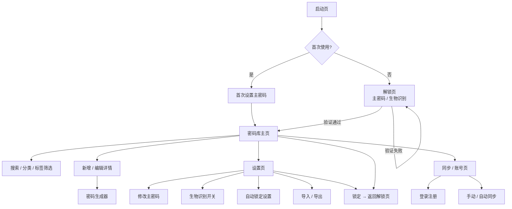

# 个人密码管理器（Android APK）— 产品需求文档（PRD）

## 一、项目信息

| 项目 | 内容 |
|---|---|
| 文档语言 | 简体中文 |
| 项目名称 | `personal_password_vault` |
| 技术栈 | uni-app（Vue 语法，HBuilderX 开发），打包为 Android APK |
| 目标平台 | Android（暂不包含 iOS） |
| 交付形式 | 完整源码 + HBuilderX 构建/打包指南 |
| 产品定位 | 本地优先、高安全的个人账号密码管理工具 |

**原始需求复述**：开发一款安卓手机 APK 形式的个人密码管理器，用于记录各类网站的账号与密码。对安全性要求很高。采用 uni-app 技术栈在 HBuilderX 中开发，交付完整源码与打包指南。功能选择「最全版本」，涵盖账号密码增删改查、主密码解锁、本地加密存储、强密码生成器、指纹/人脸解锁、搜索/分类/标签、云同步、网站自动填充。

---

## 二、产品定义

### 2.1 产品目标（正交三目标）

| # | 目标 | 说明 | 衡量标准 |
|---|---|---|---|
| G1 | **数据机密性（安全）** | 密码等敏感数据全链路加密，任何未授权访问（含手机丢失、数据库被拷贝）均无法还原明文 | 存储层无明文；非授权解锁失败率 100%；剪贴板/内存残留可清除 |
| G2 | **使用效率（易用）** | 让用户用最少操作完成录入、查找、生成、填充密码 | 常用操作 ≤ 3 次点击可达；搜索响应 < 500ms |
| G3 | **场景完整性（完整可靠）** | 覆盖管理全生命周期，并支持多设备同步不丢失 | P0/P1 功能全部可用；同步冲突不丢数据 |

### 2.2 用户故事

1. 作为**用户**，我希望用主密码或指纹解锁 App，以便手机丢失时他人也无法查看我的密码。
2. 作为**用户**，我希望为每个网站生成并保存高强度且唯一的密码，以便避免因密码复用导致的撞库风险。
3. 作为**用户**，我希望按网站名/分类/标签快速搜索账号，以便在需要时能立刻找到对应凭证。
4. 作为**用户**，我希望在多台设备间同步密码库，以便换机或重装后数据不丢失。
5. 作为**用户**，我希望登录网站时能自动填充账号密码，以便免于手动输入且减少被钓鱼的风险。

---

## 三、需求池（按优先级）

> P0：必须有（MVP，安全与核心数据管理）｜P1：应该有（完整体验）｜P2：锦上添花（增强/受技术可行性约束）

### P0 — 必须有

| ID | 需求 | 说明 |
|---|---|---|
| P0-01 | 主密码设置与解锁 | 首次启动设置主密码；之后的每次冷启动/唤醒须验证主密码 |
| P0-02 | 主密码安全策略 | 主密码经 KDF 派生密钥，绝不存储原文；错误次数限制与锁定退避 |
| P0-03 | 账号密码 CRUD | 字段：网站名、登录账号、密码、URL、备注；支持新增/查看/编辑/删除 |
| P0-04 | 本地加密存储 | 密码及敏感字段加密落盘，数据库文件中不含明文 |
| P0-05 | 强密码生成器 | 可配置长度与字符类型，使用密码学安全随机数生成 |
| P0-06 | 本地搜索 | 按网站名/账号关键词检索 |
| P0-07 | 自动锁定 | 切入后台/超时后自动锁定并清空内存中的明文数据 |
| P0-08 | 密码显示与复制 | 密码默认隐藏；复制后定时自动清空剪贴板 |

### P1 — 应该有

| ID | 需求 | 说明 |
|---|---|---|
| P1-01 | 指纹/人脸解锁 | 复用系统生物识别，本地验证通过后可替代主密码解锁 |
| P1-02 | 分类管理 | 内置+自定义分类（如社交/邮箱/金融），可归类条目 |
| P1-03 | 标签管理 | 为条目打多标签，支持按标签筛选 |
| P1-04 | 云同步 | 端到端加密后同步，服务端仅存密文；含账号体系与冲突处理 |
| P1-05 | 高级筛选 | 分类 × 标签 × 关键词组合筛选、排序 |
| P1-06 | 密码安全体检 | 标记弱密码、重复密码、长期未更新的密码 |

### P2 — 锦上添花

| ID | 需求 | 说明 |
|---|---|---|
| P2-01 | 网站自动填充 | 基于 Android Autofill / 无障碍服务，依赖原生插件（技术风险见第七节） |
| P2-02 | 数据导入/导出 | 加密备份文件的导入导出，用于迁移与容灾 |
| P2-03 | 密码更新提醒 | 为条目设置提醒周期，到期提示更换 |
| P2-04 | 主题与多语言 | 深色模式、语言切换 |
| P2-05 | 使用记录 | 记录条目的查看/修改时间与次数 |

---

## 四、关键功能点说明（含安全边界）

### 4.1 主密码系统

- 首次启动强制设置主密码，长度与复杂度校验（建议 ≥ 8 位，含大小写/数字/符号中的多类）。
- 主密码**不落盘、不上传**。使用 KDF（如 PBKDF2/Argon2，高迭代次数 + 随机盐）派生数据加密密钥。
- 校验主密码：用派生密钥解密一个固定的校验块，成功即通过；不保存主密码哈希以外的可逆信息。
- 错误尝试：连续错误 N 次后进入指数退避锁定（如 30s → 1min → 5min）。
- 修改主密码：须验证旧密码 → 用旧密钥解密全部数据 → 用新密钥重新加密写回，全程失败需回滚。
- **安全边界**：明确告知用户「忘记主密码将无法找回，加密数据不可恢复」。不提供任何后门或在线重置绕过加密。

### 4.2 本地加密存储

- 敏感字段（密码、备注、URL 等）字段级加密；密钥由主密码派生，禁止硬编码密钥。
- 推荐方案：SQLite 存储 + 字段级 AES-GCM（带完整性校验），或整库加密。
- 明文仅存在于内存，**锁定/切后台/超时后立即清空**内存中的明文与派生密钥。
- **安全边界**：日志、崩溃报告、剪贴板、截图中不得出现明文密码；App 内预览建议防截屏（可选）。
- 数据库文件权限限定应用私有目录，避免被其他应用读取。

### 4.3 账号密码 CRUD

- 必填：网站名、密码；选填：账号、URL、分类、标签、备注。
- 密码输入框默认掩码，支持「显示/隐藏」切换；生成后可直接采用。
- 复制密码到剪贴板后，定时（如 30–60s）自动清空剪贴板，防止残留。
- 删除条目需二次确认；可选「回收站」软删除（P2）。

### 4.4 强密码生成器

- 可配置项：长度（默认 16）、是否含大写/小写/数字/符号、是否排除易混淆字符（0/O/1/l）。
- 必须使用**密码学安全随机数**（如 `crypto.getRandomValues`），禁止 `Math.random()`。
- 生成结果可一键填充到输入框或复制到剪贴板（复制同样适用清空策略）。
- **安全边界**：生成的密码不写入日志，不在多条目间复用同一随机序列。

### 4.5 生物识别解锁（P1）

- 通过系统 Biometric API 在本地验证，**不上传任何生物特征**。
- 首次启用需先验证主密码授权；验证通过后解锁由主密码派生的密钥。
- 设备无生物硬件/未录入/验证失败时，回退到主密码输入。
- **安全边界**：生物识别仅作为「解锁密钥」的手段，不改变底层加密方案；多个错误后同样触发退避锁定。
- **需在真机验证** uni-app 生物识别 API 的兼容性与稳定性（见第七节）。

### 4.6 搜索 / 分类 / 标签

- 搜索在**解密后的内存数据**中进行，避免为检索而建立明文索引落盘。
- 分类、标签等元数据建议一并加密，防泄露使用习惯；如为性能考虑明文存储需明确记录取舍。
- 组合筛选（分类 × 标签 × 关键词）结果需实时刷新。

### 4.7 云同步（P1）

- **端到端加密**：本地加密后的密文才上传，服务端与传输链路均不接触明文与密钥。
- 需要账号体系（登录/注册）与后端存储方案（见第七节待确认）。
- 冲突处理：以更新时间戳 + 设备 ID 合并，冲突时保留双方版本供用户选择，禁止静默覆盖丢数据。
- 提供手动「立即同步」与自动同步开关；展示上次同步时间与状态。
- **安全边界**：同步密钥由主密码体系派生或独立密钥管理，禁止服务端持有可解密的密钥。

### 4.8 网站自动填充（P2，受技术可行性约束）

- 目标：在浏览器/App 登录页自动填充已保存的账号密码。
- Android 实现路径：优先 Android Autofill Framework（安全、无需 Root），备选无障碍服务（AccessibilityService）。
- **安全边界**：仅在用户明确确认后填充；按域名匹配凭证，防止钓鱼站点骗取密码；不在未知/不匹配域名自动填充。
- uni-app 下通常需**原生插件**支撑（见第七节）。

### 4.9 自动锁定

- 触发条件：切入后台、息屏、无操作超时（可配置，默认 1–5 分钟）。
- 锁定动作：清空内存明文与派生密钥，返回解锁页；云同步的临时凭据一并清除。

---

## 五、UI 设计稿说明

### 5.1 页面清单

| # | 页面 | 核心元素 |
|---|---|---|
| 1 | 启动/解锁页 | Logo、主密码输入框、生物识别按钮、错误提示与锁定倒计时 |
| 2 | 首次设置页 | 主密码 + 确认输入、强度提示、"忘记不可找回"警示、勾选确认 |
| 3 | 密码库主页 | 搜索栏、分类/标签筛选、条目列表（网站名/账号/密码掩码）、新增按钮 |
| 4 | 新增/编辑详情页 | 各字段表单、密码生成器入口、显示/隐藏、保存/删除 |
| 5 | 密码生成器页 | 长度滑杆、字符类型开关、生成结果、复制/采用 |
| 6 | 分类管理页 | 分类列表、新增/重命名/删除 |
| 7 | 标签管理页 | 标签列表、新增/重命名/删除、颜色标记 |
| 8 | 设置页 | 修改主密码、生物识别开关、自动锁定时长、防截屏、导入/导出 |
| 9 | 同步/账号页 | 登录注册、同步开关、立即同步、同步状态与时间戳 |

### 5.2 页面结构（Mermaid）

### 5.3 交互要点

- 全局密码默认以圆点/星号掩码，复制后显示倒计时清空提示。
- 危险操作（删除、关闭生物识别、导出明文相关）二次确认。
- 首次设置与修改主密码处，安全警示不可跳过（需勾选确认）。

---

## 六、非功能要求

| 类别 | 要求 |
|---|---|
| 安全性 | 存储无明文；传输端到端加密；日志/剪贴板/内存无敏感残留 |
| 性能 | 搜索响应 < 500ms；解锁 < 1s（含 KDF，视迭代次数权衡） |
| 兼容性 | 覆盖主流 Android 版本（具体最低版本见第七节待确认） |
| 可靠性 | 写入/同步失败可回滚，不产生半写入的损坏数据 |
| 可维护性 | 加密与同步逻辑模块化解耦，便于真机调试与后续审计 |

---

## 七、待确认问题（含技术可行性风险）

> 以下为进入开发前需与用户/架构确认的关键事项，其中前三项为**技术可行性风险**，直接影响范围与排期。

### 7.1 技术可行性风险（重点）

| # | 风险项 | 说明 | 需确认的问题 |
|---|---|---|---|
| R1 | **网站自动填充** | uni-app 框架下，网站自动填充依赖 Android Autofill Framework 或无障碍服务（AccessibilityService），通常需要**原生插件**支持，纯 uni-app 难以实现，且各厂商/浏览器兼容性差异大 | 是否接受 P2 阶段通过自定义原生插件实现？还是首版暂缓该功能？目标浏览器/App 范围？ |
| R2 | **云同步后端方案** | 云同步需先确定后端服务方案及账号体系，否则无法开发 | 采用哪种后端：自建服务器 / 云开发（如 uniCloud）/ 第三方 BaaS？是否需要独立账号体系（手机号/邮箱登录）？服务端部署与费用由谁承担？端到端加密的密钥方案如何设计？ |
| R3 | **生物识别** | uni-app 提供生物识别相关 API，但不同 Android 版本/机型/厂商 ROM 表现不一，需**真机验证** | 目标 Android 最低版本？是否需要覆盖指纹 + 人脸两种？以哪几款真机作为验证基准？验证失败时的降级方案是否接受（回退主密码）？ |

### 7.2 产品与策略确认

| # | 问题 | 说明 |
|---|---|---|
| Q1 | **忘记主密码策略** | 方案为「不可找回，数据不可恢复」。请用户明确接受此安全取舍（避免后门）。 |
| Q2 | **加密方案选型** | KDF（PBKDF2 / Argon2）、对称算法（AES-GCM）、密钥派生参数由架构师最终确定，需在保证安全与解锁速度间权衡。 |
| Q3 | **数据备份/容灾** | 是否首版就需要加密导入导出（P2-02）以防数据丢失？ |
| Q4 | **目标平台范围** | 确认仅 Android，暂不做 iOS / H5。 |
| Q5 | **应用分发方式** | 仅本地打包 APK 自用，还是需上架应用市场（影响签名、权限声明、隐私合规）。 |
| Q6 | **无障碍服务隐私合规** | 若采用无障碍服务实现自动填充，涉及敏感权限声明与应用市场审核风险，是否接受。 |

---

## 八、范围建议（给架构与开发）

- **首版（MVP）聚焦 P0**：主密码体系 + 加密存储 + 账号密码 CRUD + 生成器 + 本地搜索 + 自动锁定 + 剪贴板清空。此范围纯 uni-app 可实现，安全风险可控。
- **第二阶段交付 P1**：生物识别（真机验证后）、分类/标签、云同步（后端方案确定后）、安全体检。
- **第三阶段评估 P2**：自动填充（原生插件可行性确认后）、导入导出、提醒等。
- 建议架构设计阶段即预留原生插件扩展位与同步模块抽象，降低后续接入成本。
